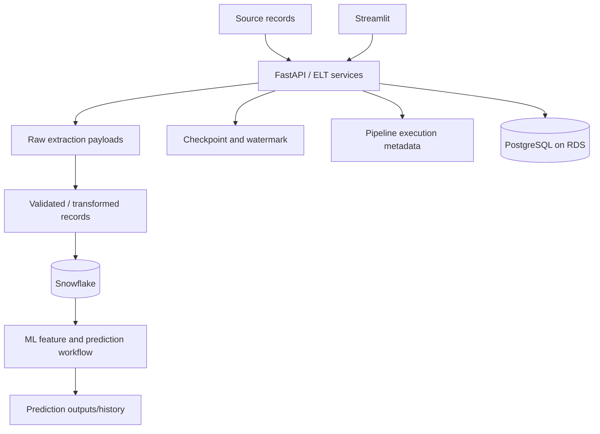

# Data Architecture

## Logical architecture

This is a logical view. Confirm physical raw-file storage, exact table names and prediction-history location from the repository's live configuration and schema definitions.

## Storage responsibilities
| Domain | Platform/responsibility |
|---|---|
| Relational application state | PostgreSQL on Amazon RDS |
| Pipeline execution history | PostgreSQL/backend persistence as configured |
| Checkpoint/watermark | Persistent store used by pipeline code |
| Raw extracted payloads | Verify actual file/object store configuration |
| ML feature data | Snowflake |
| Prediction history/output | Verify actual backend model/schema configuration |

## Lifecycle
1. Extract source records.
2. Persist raw payload/progress according to implementation.
3. Validate, normalize and deduplicate.
4. Load target data.
5. ML services read required feature data from Snowflake.
6. Backend exposes run/prediction history.
7. Streamlit retrieves and displays API responses.

## Data quality
- Required-field/type validation.
- Stable keys and duplicate handling.
- Idempotent loads/upserts.
- Checkpoint advances only after successful persistence.
- Explicit rejected-record handling.
- Reconciliation of extracted, duplicate, new and loaded counts.
- UTC timestamps for persisted event metadata.

## Security/governance
- Never commit credentials or production data.
- Restrict RDS network access to backend security groups.
- Use least-privilege Snowflake roles.
- Encrypt connections and storage where supported.
- Define retention/deletion policies and mask sensitive log values.

## Confirm before publishing exact physical design
- PostgreSQL table names, keys, constraints and indexes.
- Snowflake database/schema/warehouse/table names.
- Raw payload storage provider and retention.
- Prediction history storage location.
