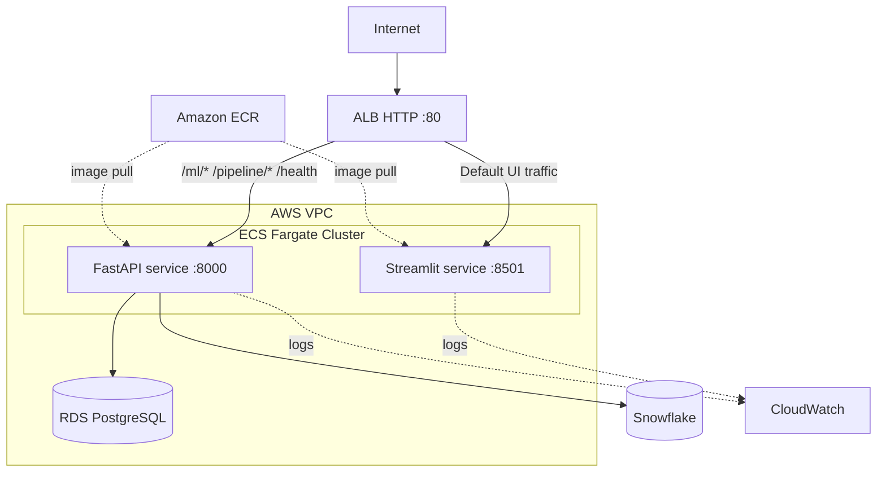
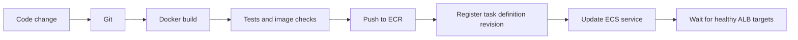

# Deployment Architecture

## Verified AWS environment
Region: `ap-south-1` (Mumbai)

| Resource | Value |
|---|---|
| ECS cluster | `ai-task-management-cluster` |
| ALB | `ai-task-alb` |
| Listener | HTTP :80 |
| Frontend service | `ai-task-frontend-service` |
| Frontend target group | `ai-task-frontend-tg`, port 8501 |
| Backend service | `ai-task-api-task-service` |
| Backend target group | `ai-task-api-tg`, port 8000 |
| Frontend task definition | `ai-task-frontend-task:1` |
| Backend task definition | `ai-task-api-task:2` |
| Frontend ECR repository | `ai-task-management-frontend` |
| CloudWatch log group | `/ecs/polished-server-irqktd` |

ALB DNS used for smoke tests: `ai-task-alb-45721397.ap-south-1.elb.amazonaws.com`.

## Deployment diagram

## Network
- ALB security group accepts public HTTP 80 and HTTPS 443 ingress as configured.
- ECS security group accepts ports 8000 and 8501 only from the ALB security group.
- RDS security group accepts port 5432 from the ECS security group.
- ECS tasks use `awsvpc` networking and were configured with public IP assignment enabled.
- Consider private subnets with NAT/VPC endpoints for production task networking.

## Build and release

Recommended release process:
1. Review changes and ignore rules.
2. Run tests and build images.
3. Tag images with immutable Git commit SHA and a release tag.
4. Push to ECR.
5. Register task definition referencing immutable image tag/digest.
6. Update ECS service and wait for steady state.
7. Smoke-test frontend, health, ELT and ML routes.
8. Retain previous task definition/image for rollback.

## Runtime configuration
- Frontend `API_BASE_URL` points to the ALB DNS name.
- Streamlit listens on `0.0.0.0:8501`; health path `/_stcore/health`.
- FastAPI listens on port 8000; health path `/health`.
- Inject DB/Snowflake credentials securely at runtime.

## Production backlog
- Add ACM certificate and HTTPS listener; redirect HTTP to HTTPS.
- Configure ECS autoscaling and multi-AZ desired task counts.
- Test ALB stickiness for Streamlit WebSocket sessions with multiple tasks.
- Budget RDS connections and consider RDS Proxy.
- Add CloudWatch alarms/dashboards and ECS rollback.
- Move tasks to private networking where appropriate.
- Use Secrets Manager/SSM and least-privilege IAM.
- Publish a load-test report before claiming 150 concurrent users.
