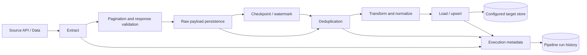

# ELT Pipeline Architecture

## Logical flow

## Stages
1. **Extract:** call source APIs, validate status and response shape, handle pagination, reuse HTTP sessions where appropriate and apply bounded retries.
2. **Persist:** save raw batches/progress where implemented. Advance checkpoints only after corresponding data is safely persisted/loaded.
3. **Deduplicate:** use stable business/source keys and idempotent load semantics.
4. **Transform:** normalize fields/types, validate required values and explicitly record rejected records.
5. **Load:** use transactions or batch operations and upsert/merge where updates are possible. Record counts and status.

## API surface verified/referenced
| Endpoint | Purpose |
|---|---|
| `POST /pipeline/run` | Trigger a pipeline run |
| `GET /pipeline/runs?limit=20&offset=0` | Paginated run history |
| `GET /pipeline/runs/{run_id}` | Individual run details |
| `GET /health` | Backend health |

Confirm exact schemas against the current FastAPI route definitions before changing the API contract.

## Run metadata
Capture execution ID, batch ID, start/completion timestamps, status, extracted, previously processed, duplicate, new and loaded counts, recovery indicator, duration and error details.

A verified run returned `NO_NEW_RECORDS`, 200 extracted, 200 previously processed, zero duplicates, zero new and zero loaded. That is an expected no-new-data outcome, not a failure.

## Failure handling
| Failure | Safe behavior |
|---|---|
| Source request fails | Bounded retry; do not advance checkpoint |
| Pagination interrupted | Resume/replay safely |
| Raw persistence fails | Do not mark batch complete |
| Transform rejects row | Record reason and apply explicit reject policy |
| Load fails | Roll back where possible; retry idempotently |
| Process restarts | Recover unfinished work without duplicate target rows |

## Concurrency and operations
- Prevent overlapping runs for the same source unless partitioned parallelism is implemented.
- Use run locks/idempotency keys.
- Bound batch size and source concurrency.
- Move long-running work to a background queue/worker when required.
- Monitor freshness lag, duration, retries, counts and failure rate.

## Verify against code before claiming
- [ ] Raw payload location and retention
- [ ] Checkpoint commit ordering
- [ ] Stable deduplication key
- [ ] Transaction/upsert strategy
- [ ] Restart recovery
- [ ] Overlapping-run protection
- [ ] Rejected-record handling
- [ ] Scheduler/worker mechanism
