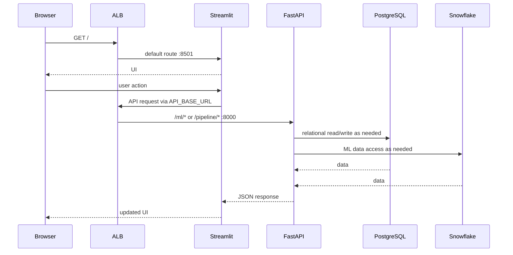

# Low-Level System Design: 150 Concurrent Users

## 1. Objective and status
This document describes a capacity design target for 150 concurrent active users. It is **not** a claim that 150 users have passed a load test. Concurrent users are not requests per second: Streamlit sessions can hold WebSockets open while making intermittent API calls.

## 2. Current known baseline
| Tier | Known deployed configuration |
|---|---|
| Streamlit | ECS Fargate, 0.5 vCPU, 2 GiB, port 8501, desired count 1 |
| FastAPI | ECS Fargate, port 8000; confirm live CPU/memory from task definition |
| ALB | HTTP listener port 80 |
| PostgreSQL | Amazon RDS |
| Snowflake | Used by ML feature/prediction workflow |

## 3. Request sequence

## 4. Design for 150 concurrent users

### Frontend
- Run multiple Streamlit tasks across Availability Zones.
- Configure ECS Service Auto Scaling using CPU and memory; validate active-session and WebSocket behavior.
- Streamlit sessions are stateful and use WebSockets. Test ALB target-group stickiness/session affinity when multiple frontend tasks are registered.
- Keep durable state in backend storage, not only in process memory.
- Measure memory per active session and WebSocket stability during scale-out/scale-in.

### Backend
- Run multiple FastAPI tasks behind the backend target group.
- Scale using CPU, memory, request latency and request volume.
- Bound expensive prediction and ELT concurrency; set request timeouts and payload limits.
- Make retryable operations idempotent. Use background workers/queues for long-running ELT rather than holding browser requests open.

### Database
- The SQLAlchemy pool configuration previously reviewed used `pool_size=15` and `max_overflow=5` per engine/process. It is not a global connection cap.
- Approximate pool ceiling is task/process count multiplied by up to 20 connections per engine, depending on worker/process topology.
- Budget connections against the RDS `max_connections`, reserving capacity for admin, migrations and monitoring.
- Consider RDS Proxy before scaling API tasks substantially.
- Monitor connections, CPU, free memory, query latency and slow queries.

### Snowflake and ML
- Bound concurrent queries and inference jobs.
- Separate interactive prediction traffic from batch ELT workloads if they contend for compute.
- Cache stable analytics where freshness requirements allow.
- Record request ID, model/version, status and duration.

## 5. Initial load-test hypothesis
These are starting test values, not guaranteed production sizing:
| Tier | Starting test topology | Signals |
|---|---|---|
| Streamlit | 2 tasks initially; test 3–5 | CPU, memory, active sessions, WebSocket errors |
| FastAPI | 2 tasks initially; test 2–4 | CPU, memory, p95 latency, request rate |
| RDS | Existing instance baseline | Connections, CPU, memory, I/O latency |
| Snowflake | Controlled warehouse workload | Query duration, queue time, credits |

Tune from measurements and cost constraints; do not assume these counts prove capacity.

## 6. Load-test plan
1. Test 10, 25, 50, 100 and 150 virtual users.
2. Model realistic navigation, analytics/history reads and prediction requests.
3. Test ELT separately, then test mixed traffic if that matches expected usage.
4. Ramp gradually and hold 150 users for 15–30 minutes.
5. Record p50/p95/p99 latency, error rate, CPU, memory, task restarts, RDS connections and Snowflake queue time.

Suggested objectives to agree with stakeholders: <1% steady-state API errors; p95 ordinary read endpoint latency <1 second; no OOM/task restarts or database connection exhaustion. Prediction latency should have its own target. These are proposed objectives, not measured results.

## 7. Reliability/security
- ALB health checks and ECS deployment circuit breaker/rollback.
- HTTPS via ACM before handling real user data.
- Least-privilege IAM roles and secrets in Secrets Manager/SSM.
- Authentication/authorization and rate limiting for public APIs.
- Alarms for ALB 5xx/unhealthy targets, ECS CPU/memory/restarts and RDS connection pressure.
- Avoid logging credentials or sensitive payloads.

## 8. Evidence required for a 150-user claim
Publish test date, commit/image digest, task sizes/counts, workload script, ramp profile, p50/p95/p99, error rate, ECS/RDS/Snowflake metrics, bottlenecks and remediation. Claim 150-user support only after acceptance criteria pass on the documented configuration.
