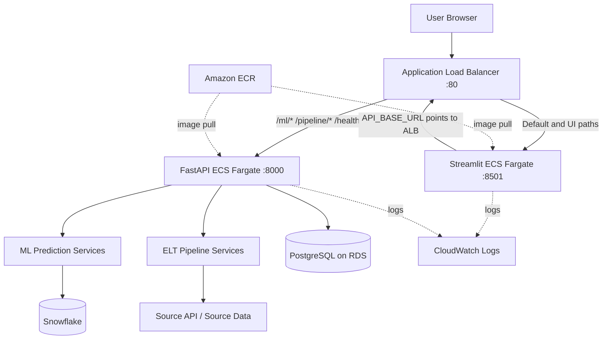

# System Architecture

## Overview
The application consists of a Streamlit frontend, FastAPI backend, ML prediction and ELT services, PostgreSQL on Amazon RDS, and Snowflake. Docker images are stored in Amazon ECR and run on Amazon ECS Fargate. One Application Load Balancer (ALB) routes browser and API traffic.

## Components
- **Streamlit:** serves the UI on port 8501; pages include ELT pipeline, ML analytics and prediction history.
- **FastAPI:** serves API requests on port 8000 and orchestrates backend, ML and ELT operations.
- **PostgreSQL/RDS:** relational application and pipeline state, as configured by the backend.
- **Snowflake:** analytical/ML feature and prediction workflow data platform.
- **ECS Fargate:** runs frontend and backend containers.
- **ECR:** stores container images.
- **ALB:** provides a single public entry point and path-based routing.
- **CloudWatch Logs:** receives ECS container logs.

## ALB routing
| Priority | Path | Target |
|---:|---|---|
| 10 | `/ml/*` | FastAPI, port 8000 |
| 20 | `/pipeline/*` | FastAPI, port 8000 |
| 30 | `/health` | FastAPI, port 8000 |
| Default | Everything else | Streamlit, port 8501 |

The frontend task uses `API_BASE_URL` pointing to the ALB DNS name. Streamlit health check: `/_stcore/health`; backend health check: `/health`.

## Request flow
1. Browser requests the application URL; ALB default route forwards to Streamlit.
2. Streamlit renders a page.
3. The page calls FastAPI through `API_BASE_URL`.
4. ALB routes `/ml/*` and `/pipeline/*` to FastAPI.
5. FastAPI accesses PostgreSQL and/or Snowflake and returns JSON.
6. Streamlit renders the response.

## Verified
- `/` returned HTTP 200 and Streamlit HTML.
- `/health` returned `healthy`.
- `/pipeline/runs?limit=20&offset=0` returned pipeline history.
- `/ml/prediction-runs?limit=20&offset=0` returned six prediction runs.

## Not yet proven by these smoke tests
150-user capacity, autoscaling, multi-task frontend session affinity, HTTPS, failover and disaster recovery.
